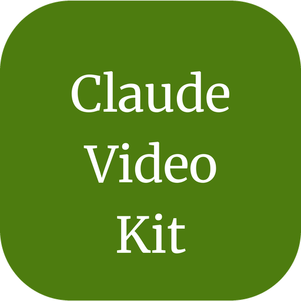

<p align="center">
  
</p>

<h1 align="center">Claude Video Kit</h1>

<p align="center">Drop-in templates that make Claude Code edit video like a careful editor: source footage stays untouched, every asset has a licence on record, every render is measured before it counts.</p>

<p align="center">
  <a href="https://github.com/tansuasici/claude-video-kit/blob/main/CHANGELOG.md">Changelog</a>
</p>

<p align="center">
  <a href="https://www.npmjs.com/package/@tansuasici/claude-video-kit"></a>
  
</p>

> **Status:** early 0.1 work. This is the skeleton: the ruleset, the edit map
> and the base hooks. Skills for the long-video-to-shorts and talk-to-reel
> flows land next.

## The Problem

Out of the box, Claude Code edits video like a script that has never been
burned. It will:
- Re-encode or overwrite the only copy of the source file
- Drop in a "royalty-free" track nobody checked
- Call a render done because ffmpeg exited 0
- Put an unchecked number in a subtitle
- Start a paid generation call without saying what it costs

## The Solution

A `CLAUDE.md` ruleset, an edit map and hooks that enforce one loop:

**Ingest → Select → Cut → Compose → Render → QC**, every time.

The cardinal rule: **source footage is read-only.** Every cut writes a new
file to `work/` or `renders/`. On top of that:
- An asset with no row in `EDIT_MAP.md → Assets` never enters a render.
- A render is done only after frame samples, ffprobe and a loudness measurement
  match its row in `EDIT_MAP.md → Delivery`.
- Paid generation shows the cost and waits for your yes.
- Numbers and claims on screen need a source.

The kit doesn't publish. It stops at `renders/`; you, or Claude Marketing
Kit's approval gate, take it from there.

## Requirements

macOS first; no GPU needed.
- [ffmpeg](https://ffmpeg.org/) (with ffprobe) for cutting, encoding and measuring
- [Whisper](https://github.com/openai/whisper) for transcripts and subtitles
- [Remotion](https://www.remotion.dev/) for composed titles and overlays (optional)
- bash, git and python3 (Node 18+ for npx)

## Quick Start

From your project folder:

```bash
npx @tansuasici/claude-video-kit init
```

Then start a Claude Code session and fill in `EDIT_MAP.md` (project, source
footage, style, delivery, assets) with Claude. The map is read first every
session.

### From a clone

```bash
git clone https://github.com/tansuasici/claude-video-kit ~/claude-video-kit
bash ~/claude-video-kit/install.sh "$PWD"
```

### As a Claude Code plugin

Inside Claude Code:

```
/plugin marketplace add tansuasici/claude-plugins
/plugin install video-kit@tansuasici
```

The plugin brings the skills, agents and hooks. The kit's `CLAUDE.md` rules
don't load and nothing is added to your repo; at session start a hook tells
Claude where the `EDIT_MAP.md` template is. To get the rules and the map in
your repo, use npx or the clone.

### Installer options

| Flag | Description |
|------|-------------|
| `--upgrade` | Update kit-managed files |
| `--force` | Replace kit files that already exist |
| `--gitignore` | Keep the kit out of your repo (also ignores `work/` and `renders/`) |
| `--dry-run` | Print what would happen; change nothing |

These work with `npx @tansuasici/claude-video-kit init` and with `install.sh`.

Your overlay (`EDIT_MAP.md`, `CLAUDE.project.md`, `linear.md`) is never
overwritten. `npx @tansuasici/claude-video-kit uninstall` (or
`bash ~/claude-video-kit/uninstall.sh "$PWD"` from a clone) asks first, then
deletes only the files the kit installed; `--keep-project` also keeps the
overlay.

### Next to another Claude kit

The Code, Research, Design and Marketing kits use the same `CLAUDE.md` and the
same hook names, so two kits can't share a folder. `install.sh` and
`uninstall.sh` stop and change nothing when they find one of those kits in the
target folder.

Install this kit into a subfolder instead, and open Claude Code in that
subfolder:

```bash
bash ~/claude-video-kit/install.sh "$PWD/video"
cd video && claude
```

Hooks only run from the folder the session opened in.

### With Claude Marketing Kit

The two kits share one file, `video-brief.md`: Marketing Kit writes the script,
the channel and the evidence; this kit reads it before selecting and cutting.
Neither kit needs the other. Without a brief, you describe the cut in chat.

## Hooks

| Hook | Event | Does |
|---|---|---|
| `session-start.sh` | SessionStart | Reports whether `EDIT_MAP.md` is filled, shows Project and the first Delivery row, lists `linear.md → Now`. |
| `prompt-router.sh` | UserPromptSubmit | Adds reminders for the edit map, read-only source, licences, render checks, paid generation, subtitle claims and publishing. |
| `branch-protect.sh` | PreToolUse (Bash) | Blocks pushes to `main`/`master` and force-pushes. |
| `block-dangerous-commands.sh` | PreToolUse (Bash) | Blocks destructive shell commands that are hard to reverse. |

Gates for source footage, licences, render checks and paid calls are planned
for 0.1. Until they exist, those rules are `CLAUDE.md` instructions, not
enforced checks.

## What's Inside

```
CLAUDE.md                 ruleset (tiered boot, the loop, cardinal rule, approvals, verification)
EDIT_MAP.md               Project, Source footage, Style, Delivery, Assets,
                          Evidence, Learnings
CLAUDE.project.md         your project overlay (never touched by upgrades)
linear.md                 open work: Now / Next / Later (created on install)
.claude/hooks/            4 hooks + lib/
.claude/settings.json     hook wiring and permissions
```

## Contributing

PRs welcome. Open an issue first for a new skill or flow.

## License

MIT. See [LICENSE](https://github.com/tansuasici/claude-video-kit/blob/main/LICENSE).
